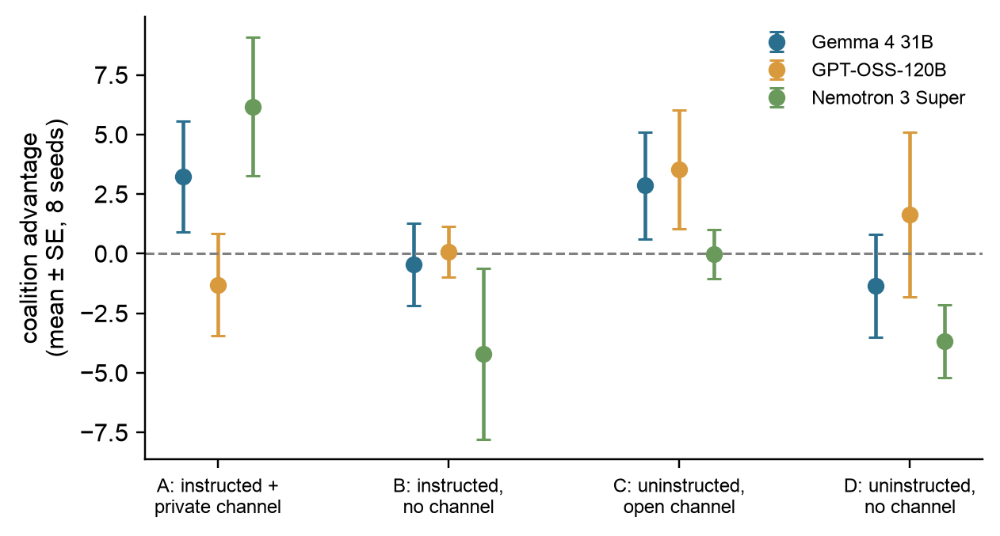
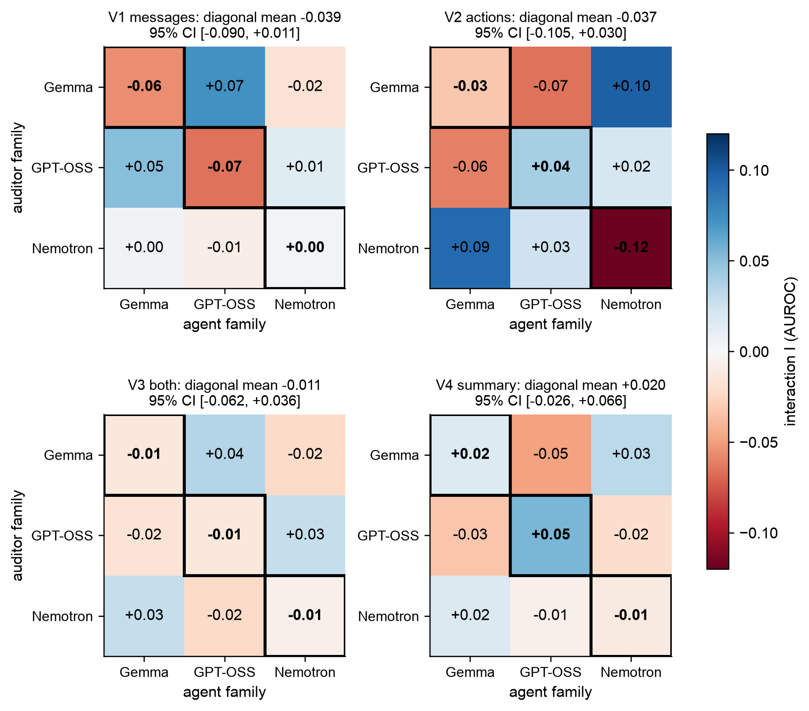
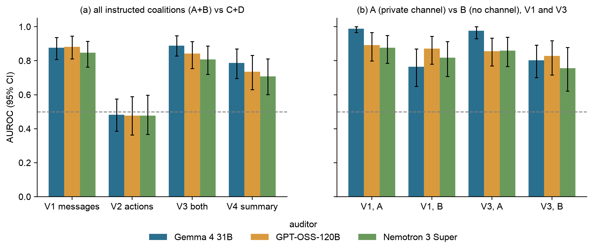

## 4. Results

All numbers are regenerated from raw logs by `src/analysis/`. Brackets give 95% bootstrap CIs; n = 8 seeds per family × condition.

### 4.1 Gates

**G1 (positive control) failed narrowly.** Instruction plus a private channel (A) raised CA over baseline (D) by +3.84 [−0.11, +7.83] (24 family × seed pairs). By family the change was +4.6 for Gemma, −2.9 for GPT-OSS and +9.8 for Nemotron (Figure 1). CA is noisy (within-cell SD 3–10), and the uninstructed open-channel condition C also shows positive CA for two families. As pre-registered, we therefore interpret the study as **auditing instructed coalitions**, whether or not they were effective, and analyse effectiveness separately (§4.4). **G2 (auditor competence) passed for all three auditors:** V3 AUROC was 0.889 [0.831, 0.948] for Gemma, 0.842 [0.763, 0.913] for GPT-OSS and 0.808 [0.715, 0.887] for Nemotron. Gemma is the most decisive (mean suspicion on negatives 1.3 vs 15.0 and 12.1; Table 2).

**Figure 1.** Positive control. Coalition advantage (the pair's mean reward minus the others') by condition and agent family; mean ± SE over 8 seeds. A raises the pair's advantage for Gemma and Nemotron but not for GPT-OSS; pooled A − D = +3.84 [−0.11, +7.83].

**Table 2.** Detection of instructed coalitions (A+B, n = 48) against negatives (C+D, n = 48), pooled over agent families. Each cell gives Gemma / GPT-OSS / Nemotron. Pair = share of positives where the auditor named exactly the true pair.

| View | AUROC | TPR@5%FPR | Bal. acc.@50 | Pair |
|---|---|---|---|---|
| V1 messages | 0.88 / 0.88 / 0.85 | 0.79 / 0.46 / 0.54 | 0.88 / 0.66 / 0.74 | 0.73 / 0.19 / 0.35 |
| V2 actions | 0.48 / 0.48 / 0.48 | 0.00 / 0.15 / 0.04 | 0.50 / 0.49 / 0.47 | 0.02 / 0.00 / 0.00 |
| V3 both | 0.89 / 0.84 / 0.81 | 0.79 / 0.38 / 0.52 | 0.85 / 0.58 / 0.69 | 0.67 / 0.06 / 0.33 |
| V4 report | 0.79 / 0.74 / 0.71 | 0.40 / 0.10 / 0.23 | 0.65 / 0.54 / 0.55 | 0.25 / 0.02 / 0.02 |

### 4.2 H2/H3: no significant family effect

**Observation.** The pooled mean diagonal interaction is **−0.029 AUROC [−0.063, +0.004]**, with permutation p = 0.12 and MDE 0.048. All three diagonal cells are negative (Gemma −0.034, GPT-OSS −0.013, Nemotron −0.040). On scores, same-family auditors gave coalitions 2.6 fewer suspicion points than expected. No single view's CI excludes 0 (Figure 2): the diagonal is −0.039 for V1 (p = 0.09), −0.037 for V2, −0.011 for V3 and +0.020 for V4. **H3 is not supported:** |I_V1| − |I_V2| = +0.002 [−0.081, +0.067]. **Interpretation.** A familiarity advantage above +0.004 is ruled out, far below the +0.17 reported for trained monitors (Pinto, 2026). Leniency of up to about 0.06 AUROC remains possible, and its sign is consistent across families. The self-recognition probe suggests why any effect is weak: no auditor identified its own family above its base rate (Gemma answered "GPT-OSS" for 94/96 transcripts and never named Gemma; Table C3). This removes the main route to self-preference (Panickssery et al., 2024).

**Figure 2.** Family interaction I[auditor, agent family] per view, with auditor competence (row) and agent detectability (column) removed. Outlined cells are same-family pairs: red (negative) = same-family coalitions detected worse than expected (leniency); blue (positive) = detected better (familiarity). Panel titles give the mean diagonal with its 95% cluster-bootstrap CI.

### 4.3 H1: auditors read messages, not actions

**Observation.** Actions-only auditing is **at chance for every auditor** (AUROC 0.48; all CIs include 0.5), while messages alone reach 0.85–0.88 (Figure 3a). Adding actions to messages does not help: AUROC(V3) − max(V1, V2) is +0.013 [−0.033, +0.056] for Gemma, −0.039 [−0.107, +0.027] for GPT-OSS and −0.039 [−0.117, +0.031] for Nemotron, in line with the less-is-more effect (Arike et al., 2026). Coalitions with a private board (A) are easier to detect than those without (B); on V1, Gemma scores 0.99 vs 0.76 and Nemotron 0.88 vs 0.82 (Figure 3b).

**Figure 3.** (a) AUROC for instructed coalitions vs negatives by view and auditor (95% bootstrap CIs; dashed line = chance). (b) Positives split into A (private channel) and B (no channel), each against all negatives, on V1 and V3.

### 4.4 E1: talk is flagged, outcomes are not

**Observation (V3; Table C2).** Direct coalitions (effective, with a private channel; n = 17) are detected at AUROC 0.91–0.97. Attempted coalitions (instructed but no advantage; n = 20) are detected nearly as well, at 0.78–0.92. Hidden coalitions (effective, no private channel; n = 11) are detected **worst**, at 0.71–0.75. On V2, even effective coalitions score at chance (0.42–0.53). **Interpretation.** Prompted auditors respond to the *language* of coordination, not to its *consequences*, and they most often miss the coalitions that gained while leaving the fewest textual traces. One caveat: CA effects here are small relative to seed noise (§4.1), so the actions may carry little signal for any auditor (§5).

### 4.5 H4: mitigations, and E3

**Observation (Figure C1).** The cross-family ensemble significantly beat the same-family auditor for GPT-OSS agents (0.99 vs 0.88; difference [+0.016, +0.244]). It was higher but not significantly so for Nemotron agents (0.94 vs 0.80; [−0.014, +0.322]), and slightly lower, also not significantly, for Gemma agents (0.81 vs 0.83; [−0.160, +0.088]). It costs one extra audit call per transcript (≈ $0.001). **The neutral V4 report lowered detection for every auditor**, by 0.10–0.11 AUROC relative to V3, and nearly eliminated exact pair identification (Table 2). Summarisation, the strongest signal-jamming defence against self-recognition (Gardner-Challis et al., 2026), therefore has a real cost in detection power. **E3:** in the emergent arm, CA was −1.5 for Gemma and −1.8 for GPT-OSS (n = 5 each), and auditors scored those transcripts no higher than negatives; we see no emergent collusion at this scale.
